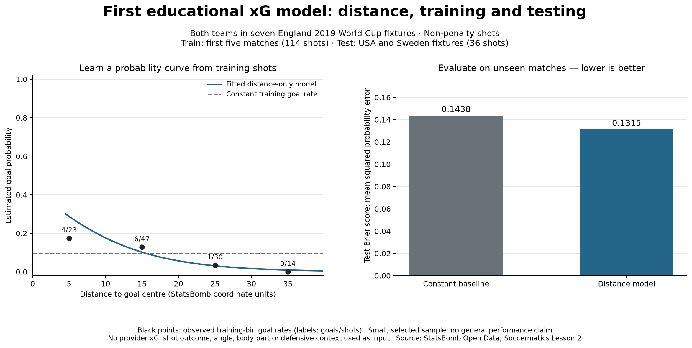

# England 2019: attacking passing involvement

**Football analytics portfolio · Python/pandas · In progress**
**Author:** Alireza Erfanian

[](https://github.com/alirezzaww/england-2019-attacking-pass-analysis/actions/workflows/evidence.yml)

**[Explore the live portfolio](https://alireza-england-2019-research.sara-erfania-6316.chatgpt.site)** ·
[Study the source](https://github.com/alirezzaww/england-2019-attacking-pass-analysis)

Which England players were involved in passing shortly before shots at the 2019
Women's World Cup—and how does that picture change with playing time, shot quality
and pitch location?

This applied case study covers seven England matches using StatsBomb Open Data.
It extends a Soccermatics exercise with reconstructed playing time, threshold
sensitivity checks and individual-event inspection. It is a guided learning project
with assistant support, not an independently developed player-valuation model.

## Read the case study

- **[Findings and football interpretation](docs/CASE_STUDY.md)**
- [Methods and definitions](docs/METHODS.md)
- [Reproduce the results](docs/REPRODUCIBILITY.md)
- [Project scope and remaining work](PROJECT_BRIEF.md)


## Findings from this sample

- **200 qualifying passes** across seven games: completed possession-team passes
  within 15 seconds before a same-possession England shot, excluding listed restarts.
- **113** remain when the following shot must have xG > 0.07; **98** at xG > 0.10.
- At 0.10, Kirby records **2.17 per reconstructed 90** and Bronze **1.43**, from
  12 and 11 passes. Kirby has the highest rate among outfield players meeting the
  chosen 270-minute display minimum.
- Nine of Kirby's 12 selected passes **started inside the final third**, while only
  two **entered it from outside**. Those are different contributions.

These are descriptive findings from a small tournament sample. They do not establish
player superiority, assists, causal chance creation or statistical significance.

## Skills demonstrated by the guided workflow

Event acquisition and filtering; possession/time matching; totals versus rates;
playing-time reconstruction; definition sensitivity; spatial analysis; evidence
reconciliation; reproducible, qualified reporting. The code was prepared with assistance;
the learning journal distinguishes coverage from independent practice.

## Run in Spyder or a terminal

Use **Python 3.11** on Windows, macOS or Linux. Clone this repository, open its
folder in a terminal, then follow [the setup guide](docs/REPRODUCIBILITY.md).
After installing `requirements-core.txt`, run the complete research pipeline:

```bash
python scripts/run_research.py --headless
```

For Spyder, select your environment's interpreter and open the numbered lesson files.
The runner executes tournament stages 11, 13–26 and then validates saved evidence.
The early numbered files remain independent learning exercises.
Internet is needed to acquire source data. Raw events are cached locally and ignored
by Git; saved derived evidence and figures are included for immediate study.
You can inspect the saved evidence without installing analysis libraries:

```bash
python scripts/check_evidence.py
```

## Educational xG modelling extension

`18_first_xg_model.py` adapts [Soccermatics Lesson 2](https://soccermatics.readthedocs.io/en/latest/gallery/lesson2/plot_xGModelFit.html)
to both teams' non-penalty shots in our seven cached fixtures. A distance-only
logistic regression trains on 114 shots from the first five matches and tests on
36 from the final two. Test Brier error is 0.1315 versus 0.1438 for a constant
training-goal-rate baseline. This tiny selected sample is for learning, not a
validated scouting model. It excludes angle, body part and defensive context.
Run `python 18_first_xg_model.py` after creating the raw cache in lesson 13.



## Repository guide

- `01_*.py`–`10_*.py`: foundational guided lessons and single-match analyses.
- `11_*.py`–`17_*.py`: tournament selection, rates, sensitivity, profiles, match variation and passing-volume comparison.
- `figures/`: charts with scope and source captions.
- `data/`: derived evidence and source-input manifest; raw cache is ignored.
- `docs/`: case study, methods, reproduction and résumé presentation.
- `reports/`: earlier England–Sweden shooting assessment.
- `LEARNING_JOURNAL.md`: findings, limitations, practice and progress.

## Status

The descriptive pipeline is implemented. Match variation, weighted rates and qualifying share of completed passes are examined. Role-specific comparison,
opportunity adjustment, statistical uncertainty and video review remain future work.
The passing case study uses provider xG. A separate educational distance-only xG
model is now implemented in lesson 18; no general predictive reliability, significance
test or finished recruitment recommendation is claimed.

[Learning journal](LEARNING_JOURNAL.md) · [Lesson archive](docs/LEARNING_GUIDE.md)
· [Résumé presentation](docs/RESUME.md)

## Sources and acknowledgement

Data: **[StatsBomb Open Data](https://github.com/hudl/open-data)**, competition 72,
season 30. Source data retains the provider's [licence](https://github.com/hudl/open-data/blob/master/LICENSE.pdf);
this project grants no additional data rights.


Foundation: [Soccermatics pass heat maps](https://soccermatics.readthedocs.io/en/latest/gallery/lesson1/plot_PassHeatMap.html)
and [passing networks](https://soccermatics.readthedocs.io/en/latest/gallery/lesson1/plot_PassNetworks.html).
Methods and code were adapted and extended with assistant support. xG is supplied
by StatsBomb for the passing analysis. Lesson 18 separately trains a small
educational model from shot outcomes, without using provider xG as an input.

## Reuse, contribute and deploy

Original code and documentation are released under [MIT](LICENSE). Provider data,
derived records, course adaptations and logos have [separate notices](THIRD_PARTY.md).
See [contributing](CONTRIBUTING.md) and [citation metadata](CITATION.cff).

The responsive static website lives in `web/`. Read [deployment and device support](docs/DEPLOYMENT.md)
to serve or publish your own copy. The website is readable on phones and computers;
Python analysis runs in a computer environment.

## Latest lesson: testing the time window

[Lesson 19](lessons/0001-time-window-sensitivity.html) and its
[research report](reports/02_time_window_sensitivity.md) compare 5, 10 and 15 seconds
before shots while keeping xG > 0.10 and playing-time denominators fixed. Selections
contain 38, 68 and 98 passes. Walsh's comparison with Bronze changes with the window.
Run `python 19_time_window_sensitivity.py` in Spyder or a terminal. The lesson HTML
can be downloaded and opened locally; GitHub displays its source.

## Passing context: compare within starting thirds

[Lesson 20](lessons/0002-pass-location-context.html) adds a
[spatial denominator comparison](reports/03_pass_location_context.md), preserving a
2,837-pass audit ledger and within-third summaries for all players. Kirby's attacking-third
qualifying share is 9/57 (15.8%), compared with Bronze's 7/81 (8.6%). These are
completed-pass shares, not completion rates or overall player-quality ratings.
Run `python 20_pass_location_context.py` after caching events with lesson 13.

## Match-sample uncertainty

[Lesson 21](lessons/0003-match-bootstrap-uncertainty.html) adds a
[paired match-bootstrap demonstration](reports/04_match_bootstrap_uncertainty.md).
The observed Kirby-minus-Bronze attacking-third gap is 7.15 percentage points;
an illustrative percentile interval from 10,000 paired fixture draws is −3.19 to
+19.13 points. Only seven selected matches are available: this is not a validated
population interval, p-value or player-quality ranking. Run
`python 21_match_bootstrap_uncertainty.py` using the saved lesson-20 evidence.

## Match score context

[Lesson 22](lessons/0004-score-state-context.html) reconstructs the score immediately
before each eligible pass and [compares leading, drawing and trailing](reports/05_score_state_context.md).
England's qualifying shares are 4.34%, 2.74% and 1.96% respectively, across all starting
locations. Trailing occurs only against USA and Sweden, preventing a causal score-effect
claim. Final scores reconcile to provider metadata; same-second ordering, halftime,
shootout exclusion and own-goal handling have tests. Run
`python 22_score_state_context.py` after lesson 13; match metadata downloads once if missing.

## Compare score states on the same fixture set

[Lesson 23](lessons/0005-within-match-comparisons.html) checks
[fixture overlap](reports/06_within_match_score_comparison.md). No fixture has eligible
passes while both leading and trailing. USA and Sweden support a drawing/trailing
comparison: 0/120 versus 12/611 when pooled over those same two fixtures. This reverses
the seven-match pooled ordering, showing why group composition must accompany a
percentage comparison. Game phase and other context remain uncontrolled. Run
`python 23_within_match_score_comparison.py` using saved lesson-22 evidence.

## Audit what a passing count represents

[Lesson 24](lessons/0006-passes-shots-possessions.html) inspects
[the attacks behind the trailing-pass total](reports/07_passes_shots_and_possessions.md).
The 12 selected passes link to three represented shots in three possessions, with four
passes per shot. Timelines and identity checks distinguish action counts from shot
counts and demonstrate why repeated shot xG must not be summed per preceding pass.
Run `python 24_passes_shots_and_possessions.py` after caching raw events with lesson 13.

## xG extension: test shot angle with training-only validation

[Lesson 25](lessons/0007-shot-angle-and-validation.html) compares
[constant, distance-only and distance-plus-angle candidates](reports/08_shot_angle_model_comparison.md).
Leave-one-match-out validation inside the first five fixtures selects distance-only:
log loss 0.2924 versus 0.3002 with angle. Both candidates use a common 105x68 reference
geometry and fold-local scaling. The last two fixtures are explicitly a reused check,
not a fresh final evaluation. This small educational result does not imply angle is
unimportant or establish production quality. Run `python 25_shot_angle_model.py`.

## Inspect probability calibration

[Lesson 26](lessons/0008-probability-calibration.html) adds a
[binned diagnostic](reports/09_probability_calibration.md) of the selected candidate's
114 out-of-fold predictions. The 32-shot 5–<10% group has a 7.46% mean prediction and
five goals (15.625% observed). These small, reused development groups do not establish
true individual-shot probabilities or practical model reliability. No recalibration
is fitted. Run `python 26_probability_calibration.py` using saved lesson-25 evidence.
