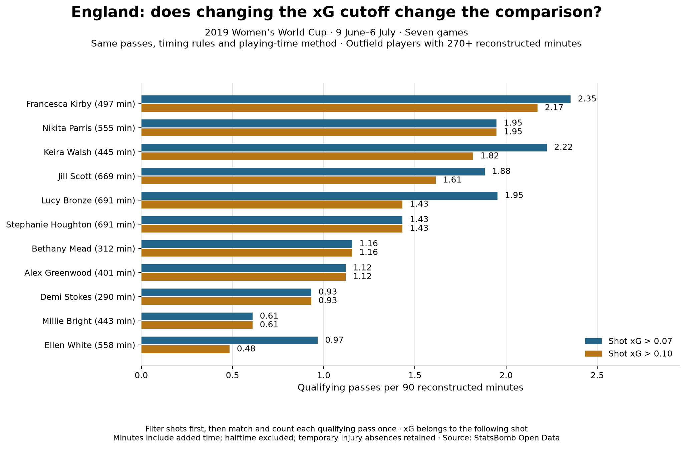
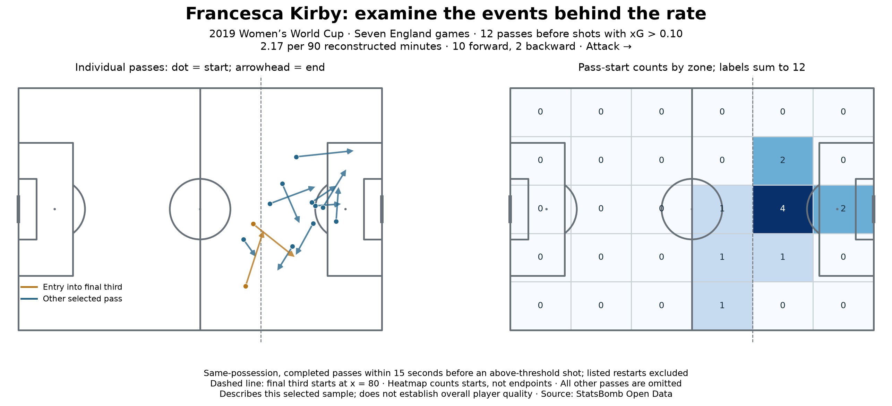
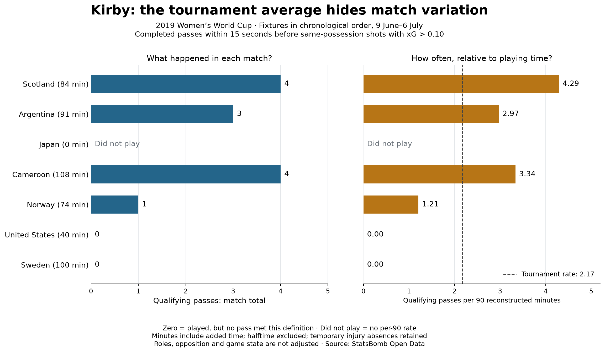
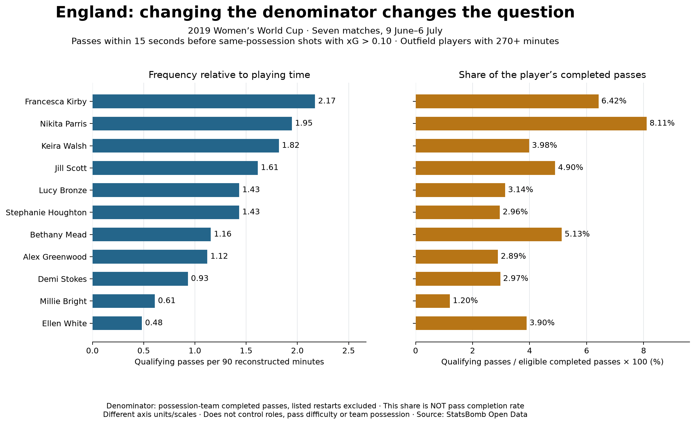

# Who was involved in England's passing shortly before shots?

**Alireza Erfanian · Applied football analysis · Guided project in progress**

## Question

How do player comparisons change when total passing involvement before shots is
adjusted for playing time, shot-quality thresholds and spatial context? The intended
audience is a coach or analyst seeking leads for further sequence review.

## Scope

Seven England fixtures, 9 June–6 July 2019. A qualifying event is a completed
possession-team pass within 0–15 seconds before an England shot in the same match,
half and possession. Listed restart types are excluded. Each pass counts once.
Filter shots before matching and deduplicating passes. [Methods](METHODS.md).

## Finding 1: volume and rate answer different questions

Bronze made 28 of the 200 selected passes; Kirby made 24. Their reconstructed
per-90 rates were 3.65 and 4.35 respectively. Bronze contributed more in total;
Kirby contributed more frequently per unit of playing time on this measure.
Differences in role, opportunities and pass difficulty remain unadjusted.

## Finding 2: analytical definitions affect the comparison

The xG > 0.07 selection contains 113 passes; xG > 0.10 contains 98. Kirby's rate
changes from 2.35 to 2.17 per 90; Bronze's from 1.95 to 1.43. Parris retains 12
selected passes, approximately 1.95 per 90 at both thresholds. Some positions change;
Kirby remains highest among displayed outfield players with 270+ reconstructed minutes.
This sensitivity check is not a significance test. The display minimum is not a
statistical guarantee.

## Finding 3: activity inside an area differs from entry into it

Kirby's 12 passes at the 0.10 cutoff contain ten forward and two backward passes.
Nine started inside the final third, while two crossed into it from outside. These
passes occurred across four games. The selected events suggest more involvement
already inside the attacking third than entry into it, within this specific sample.

## Finding 4: the tournament average hides variation

At the 0.10 cutoff, Kirby's selected pass counts were Scotland 4, Argentina 3,
Cameroon 4, Norway 1, USA 0 and Sweden 0; she did not play against Japan. Eight
of twelve passes came in two fixtures. This is not evidence of uniformly high
involvement across appearances, nor does a zero establish poor performance.

The tournament rate is 12 / 497.11 × 90 = 2.17. The simple mean of her six
appearance-level per-90 rates is 1.97; that gives a 40-minute appearance the same
weight as a 108-minute appearance. The pooled rate weights by minutes and answers
the question of event frequency across all her recorded playing time.

Removing one appearance at a time gives rates from 1.74 to 2.72. This quantifies
sensitivity to the matches included; it is not a confidence interval or a forecast.
Opposition, role and game state remain unadjusted, so the cause of variation is open.

## Finding 5: time and passing volume give different comparisons

At the 0.10 cutoff, Kirby and Parris each made 12 qualifying passes. Kirby's
rate per reconstructed 90 is higher (2.17 versus 1.95), but Parris's qualifying
share of eligible completed passes is higher: 12 / 148 = 8.11%, compared with
Kirby's 12 / 187 = 6.42%. Bronze records 11 / 350 = 3.14%.

Per-90 describes frequency over playing time. Qualifying share describes how much
of a player's completed passing met this particular shot-context definition. These
are different questions, not competing estimates of one true player-quality rank.
This share is not pass completion rate, an xG model or a causal chance-creation
probability. Positions, pass difficulty, safe buildup responsibilities and team
possession are unadjusted. Lower passing volume can produce a higher share without
establishing greater overall value.

## Provisional analyst observation

Kirby's passing involvement warrants further sequence review. She retained the
highest per-90 rate among displayed players at both tested cutoffs, with most of
her selected passes beginning inside the final third. This does not establish her
full passing style or that she was England's best passer: unrelated and failed
passes are omitted, and player roles and game contexts differ.

## Unresolved questions

What explains the observed match variation? What changes within comparable roles or after
accounting for possession? Does a larger sample support the pattern? What options,
pressure and tactical purpose are visible in the actual sequences?

Multiple passes can precede one shot; these are not independent chances or assists.
Do not sum associated shot xG as player-created xG. No causal or recruitment claim
is made. [Reproduce and inspect the evidence](REPRODUCIBILITY.md).

Source: [StatsBomb Open Data](https://github.com/hudl/open-data). Course foundation:
[Soccermatics](https://soccermatics.readthedocs.io/en/latest/gallery/lesson1/plot_PassHeatMap.html).
Prepared with assistant support; independent reproduction and explanation remain
part of the learning programme.

## Follow-up: does 15 seconds drive the finding?

At fixed shot xG > 0.10, shorter 5- and 10-second windows select 38 and 68 passes
compared with 98 at 15 seconds. Kirby retains 8 of 12 at 5 seconds, versus Walsh's
1 of 9. Walsh's rate exceeds Bronze's at 15 seconds but falls below it at 5 seconds;
that ordering depends on temporal scope. The [time-window report](../reports/02_time_window_sensitivity.md)
documents all settings without choosing a preferred player ranking. This is a
sensitivity check, not evidence of causal impact or statistical significance.

## Follow-up: compare within a starting third

Kirby starts 30.5% of her eligible completed passes in the attacking third, compared
with Bronze's 23.1%. Within that area, the qualifying shares are 9/57 (15.8%) and
7/81 (8.6%). The observed difference persists within this broad zone. These
small-sample shares do not fully account for tactical roles or pass difficulty.
The [location-context report](../reports/03_pass_location_context.md) preserves the
denominators, spatial rules and limits rather than treating the chart as a player ranking.

## Follow-up: uncertainty across observed fixtures

A paired whole-match bootstrap of the attacking-third shares retains the observed
+7.15-point Kirby-minus-Bronze difference but produces an illustrative percentile
interval of −3.19 to +19.13 percentage points (10,000 draws). These match draws span
both sides of zero. The result motivates caution about a general advantage; it does
not prove equality. Seven selected fixtures do not validate population coverage.
The [bootstrap report](../reports/04_match_bootstrap_uncertainty.md) documents pairing,
pooled ratios, zero-exposure handling and the assumptions behind this teaching extension.

## Follow-up: the score at the time of the pass

Across all pitch areas and players, the qualifying share is 4.34% while England lead,
2.74% while drawing and 1.96% while trailing. Labels use the score immediately before
the pass, not the subsequent shot result or final score. England only trailed against
USA and Sweden in these fixtures, making score state inseparable from opponent and
other context in this simple comparison. See the [score-state report](../reports/05_score_state_context.md)
for denominators, final-score validation and limits. The observed pattern does not
establish that leading improves passing.

## Follow-up: check which fixtures support the comparison

No fixture contains eligible passes in both Leading and Trailing. Drawing and Trailing
can both be observed against USA and Sweden: Drawing is 0/120 and Trailing 12/611
when pooled over that common set. The original 18 Drawing qualifiers all came from
the other five fixtures. Restricting the sample reverses the original pooled ordering,
without establishing a causal score effect. See the [within-match report](../reports/06_within_match_score_comparison.md)
for each fixture, missing comparisons and remaining differences in game context.

## Follow-up: what do the 12 trailing passes represent?

The 12 selected passes while trailing link to three assigned shots in three
possessions, each with four selected passes. Two represented shots are goals and
one is saved. This is passing involvement, not 12 separate chances. The
[shot-unit audit](../reports/07_passes_shots_and_possessions.md) adds chronological
timelines and demonstrates repeated-shot-xG duplication. Other actions and shots
without a selected preceding pass are outside this display.
