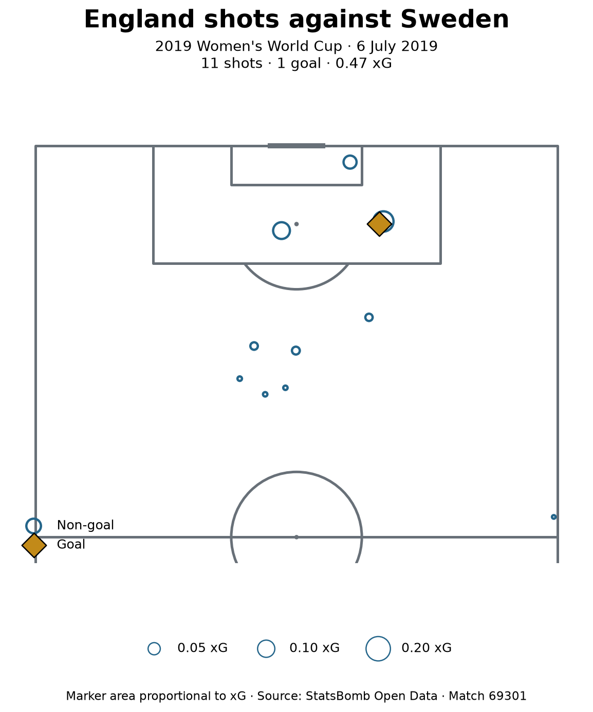

# England–Sweden: match shooting assessment

**2019 Women's World Cup · 6 July 2019 · England 1–2 Sweden**
**Question:** Did England's greater shot volume produce greater scoring opportunity?

## Assessment

England attempted 11 shots to Sweden's eight, but accumulated slightly less StatsBomb expected goals: **0.474 xG versus 0.549 xG**. Average xG per shot was approximately **0.043 for England and 0.069 for Sweden**. England therefore had more attempts, while Sweden's attempts carried a higher average estimated scoring probability. The total xG gap was small—approximately 0.075—and should not be presented as a large difference in attacking performance.

Seven of England's 11 shots were outside the penalty area, with four inside. This locates most of England's shooting volume away from the box; it does not establish why those shooting positions arose. Video and analysis of the preceding possessions would be needed to investigate whether the choices reflected defensive pressure, limited passing options, game state, or other causes.

Lucy Bronze led England with **three attempts**, totalling **0.117 xG**. Ellen White had England's highest accumulated xG, **0.139**, from one saved shot. White's single attempt therefore contributed more xG than Bronze's three attempts combined. This describes their chances in this match, not their overall attacking ability or shot selection across a season.

Francesca Kirby scored England's goal from a **0.101 xG** attempt. England's highest-xG attempt, White's, did not score. This illustrates the distinction between chance probability and actual outcome. England scored once from 0.474 xG, while Sweden scored twice from 0.549 xG. One match cannot establish persistent finishing skill, luck, or which team deserved to win.

**Conclusion:** England's additional attempts did not translate into greater total xG in this match. A useful next investigation is how the team reached its shooting positions and why so many attempts came from outside the penalty area.

## Shot map

Each marker represents one attempt; open blue circles are non-goals and the gold diamond is a goal. Marker area is proportional to StatsBomb xG. Nearby attempts can overlap. Positions use the provider's 120 × 80 coordinate grid; the attacking goal is displayed at the top.

## Evidence and scope

- Source: **StatsBomb Open Data**, match `69301`, competition `72`, season `30`: https://github.com/statsbomb/open-data
- Reproduction: run `01_getting_started.py` in the project's Python environment, including through Spyder. It loads the source data live; provider updates may alter outputs.
- Course foundation: [Using StatsBomb](https://soccermatics.readthedocs.io/en/latest/gallery/plot_UsingStatsbomb.html) and [Plotting Shots](https://soccermatics.readthedocs.io/en/latest/gallery/lesson1/plot_PlottingShots.html). The xG comparison and written assessment extend the tutorial examples.
- All 19 shot events are included. Shot goals match the fixture's 1–2 score. Own goals are recorded separately, and this match has no own-goal complication.
- Penalty-area classification uses x ≥ 102 and 18 ≤ y ≤ 62 in StatsBomb coordinates; outside means the complement. The zone counts were computed in the executed Lesson 1 notebook.
- Figures and displayed xG values are rounded; calculations retain full precision. xG is supplied by StatsBomb; no new model was trained.
- Scope is one match's recorded shots. This is not a complete tactical evaluation or a recruitment recommendation. Players without attempts are absent from the shooting rankings.
