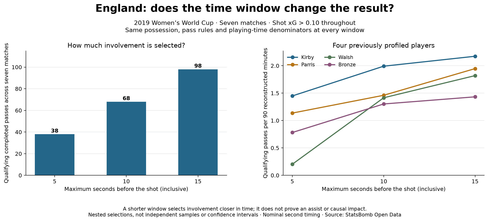

# Does the time window change the player comparison?

## Question and method

Compare inclusive 5-, 10- and 15-second windows before same-possession England shots
with StatsBomb xG strictly above 0.10. Keep the seven matches, completed-pass filters,
nearest eligible shot rule and reconstructed playing-time denominators fixed.
This extends the [Soccermatics 15-second example](https://soccermatics.readthedocs.io/en/latest/gallery/lesson1/plot_PassHeatMap.html).

## Observations

The selections contain 38, 68 and 98 unique passes respectively. Kirby has 8, 11 and
12 passes, equivalent to 1.45, 1.99 and 2.17 per 90. Walsh has 1, 7 and 9 (0.20,
1.42 and 1.82 per 90); Bronze has 6, 10 and 11 (0.78, 1.30 and 1.43 per 90).
Walsh exceeds Bronze at 15 seconds but is below her at 5 seconds. That particular
ordering is sensitive to the definition. Kirby remains prominent under all three
settings; this is descriptive stability within this selected sample.

## Interpretation and limits

A shorter window selects passes closer in recorded time to the following shot.
It does not identify assists or causal impact. More events at a wider window are
expected because these are nested selections, not independent groups. Time gaps use
nominal minute and second fields, with no subsecond precision. Seven selected games,
role differences and omitted failed/other passes limit broader interpretation.
Do not choose the window solely because it puts a preferred player ahead.

## Reproduce and inspect

Run `python 19_time_window_sensitivity.py` in the project environment, or open it in
Spyder. It uses existing lesson-14 evidence without a new download. The JSON output
in `data/19_time_window_evidence.json` includes every selected event and every player
at each setting; the figure highlights four previously profiled players rather than
an exhaustive ranking. `scripts/check_evidence.py` checks the selections, denominators
and rates, and independently reconstructs selections from raw events when available.

The assistant implemented and executed this extension. Independent practice is in
[lesson 19](../lessons/0001-time-window-sensitivity.html).
