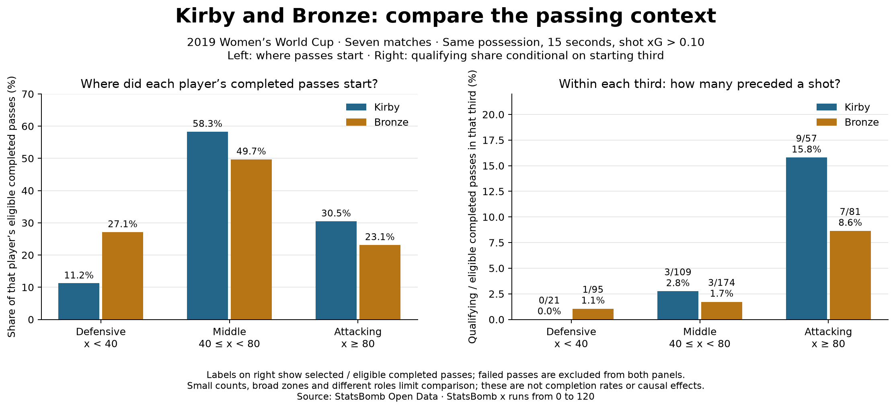

# Passing involvement within the same starting third

## Analyst question

Do Kirby and Bronze differ in where their eligible completed passes begin, and what
happens when qualifying shares are compared within the same starting third?
This extends the existing passing case study rather than implementing a new xG model.

## Method

Use the same seven England fixtures, 2,837 eligible completed possession-team passes,
listed restart exclusions, and 98 selected passes within 15 nominal seconds before
same-possession shots with StatsBomb xG strictly above 0.10.
Assign each pass by its START x: defensive third [0,40), middle third [40,80), attacking
third [80,120]. A boundary at 40 or 80 belongs to the next third. End coordinates do
not determine the starting zone, and this is not a final-third-entry measure.

For each player and zone:

- Pass-start mix = eligible completed passes from the zone / all that player's eligible completed passes.
- Within-zone qualifying share = qualifying passes from the zone / eligible completed passes from the same zone.

Both are percentages but they answer different questions. Failed passes are excluded;
these are not pass completion percentages. A zero denominator is undefined (`null`),
whereas zero qualifying passes with a positive denominator is a genuine 0%.

## Observations

Kirby's eligible completed passes start 11.2% in the defensive third, 58.3% in the
middle and 30.5% in the attacking third. Bronze's corresponding mix is 27.1%, 49.7%
and 23.1%. Their overall numbers therefore summarise different location distributions.

Within the attacking third, Kirby records 9 qualifying passes among 57 eligible
completed passes (15.79%); Bronze has 7 among 81 (8.64%). In the middle third, each
has three selected passes, but denominators differ: 109 versus 174 (2.75% versus
1.72%). In the defensive third, the figures are 0/21 and 1/95.

## Football interpretation

The higher sample qualifying share for Kirby persists when comparing attacking-third
starts. The broad location split adds context to the pooled comparison. It does not
estimate how much of the overall difference is caused by location, nor establish
player superiority. The pass could be earlier in a sequence rather than an assist.

## Limits and next investigation

Numerators are small. A third contains varied distances, angles and lanes. Pressure,
pass difficulty, receiver, scoreline, role and opposition are not controlled. Players
and events are not independent random samples. No statistical interval, significance,
causal effect or generally adjusted player rating is claimed.
Next: inspect finer spatial context and selected event sequences before making a
coaching recommendation; quantify uncertainty with a justified sampling unit when
more data is available.

## Reproducibility and audit

Run `python 20_pass_location_context.py` after lesson 13 creates the raw cache, or use
Spyder. Output `data/20_pass_location_evidence.json` preserves the entire 2,837-pass
ledger, zone rules and summaries for every recorded player, including zero-event
cells. The figure focuses on the previously compared Kirby and Bronze; it is not a
ranking. Per-player totals reconcile to lesson 17 and selected IDs to lesson 14.

`scripts/check_evidence.py` checks counts, IDs, coordinates, percentages, missing
values and raw-input reconstruction when cached files are present. Unit tests cover
boundary assignment, undefined denominators and pooled versus unweighted percentages.
Prepared and executed with assistant support; independent interpretation remains a
student task in [lesson 20](../lessons/0002-pass-location-context.html).

Data: [StatsBomb Open Data](https://github.com/hudl/open-data).
Course foundation: [Soccermatics pass heat maps](https://soccermatics.readthedocs.io/en/latest/gallery/lesson1/plot_PassHeatMap.html).
This spatial denominator comparison is a project extension, not a copied course lesson.
