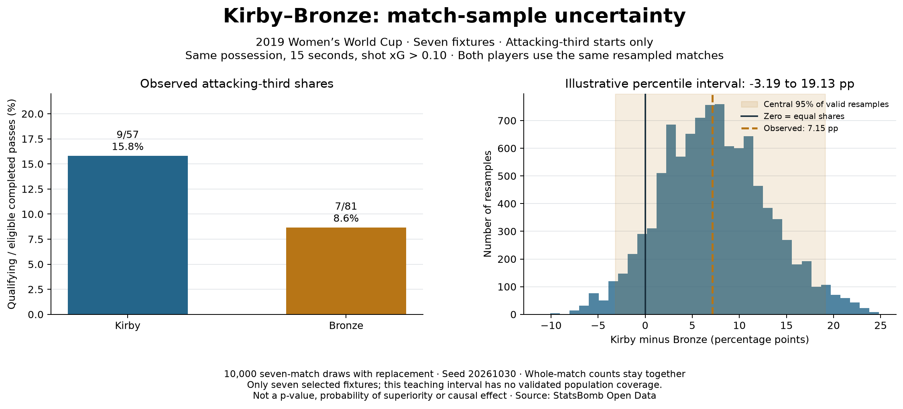

# How sensitive is the attacking-third comparison to the match sample?

## Question

Kirby's attacking-third qualifying share is 9/57 (15.79%) and Bronze's is 7/81
(8.64%). The observed difference is **7.15 percentage points**. How much does this
pooled comparison change when we resample the seven observed fixtures?

## Method and assumptions

Keep the lesson-20 pass ledger, attacking-third starts, shot xG > 0.10, 15-second
window and completed-pass denominator unchanged. Aggregate qualifying and eligible
counts by fixture for both players, including zero-exposure fixtures.
Draw seven fixtures with replacement, using the **same draw for both players**.
A repeated fixture repeats both its numerator and denominator. Pool each player's
counts before division; do not average fixture percentages. Repeat 10,000 times
with Python `random.Random` seed 20261030.

The match is the resampling unit, keeping recorded within-match sequences together.
Treating passes as independent observations would discard this shared match context.
Match resampling still assumes the fixtures can stand in for draws from a common
match distribution. These seven selected, sequential tournament fixtures have different
opponents and circumstances; that assumption is not established.

The educational percentile interval uses the 2.5th and 97.5th percentiles, with linear
interpolation at index `(n - 1) * q`. It is simpler to teach than more advanced bootstrap
intervals. It has **no validated population coverage here**, particularly with only
seven clusters. This is a transparent demonstration, not a general player-quality interval.
If either pooled denominator is zero, that replicate is recorded as invalid rather
than assigned a fictitious 0%; any reported interval then uses valid replicates only.
No invalid replicate occurred in this seeded run (10,000 valid, zero invalid).

## Results

The observed difference remains +7.1475 percentage points. The illustrative percentile
interval is **−3.1936 to +19.1253 percentage points**. The resampling distribution spans
both sides of zero: the observed ordering can reverse under different draws of these
fixtures. This is not a p-value, a probability that one player is better, evidence
of equivalence, or proof of a causal effect.

## Analyst wording

> Kirby's observed attacking-third qualifying share was higher in this seven-match
> sample. A paired whole-match resampling exercise showed substantial variation,
> including differences on both sides of zero. Broader claims need more representative
> match data and additional football context.

## Reproduce and audit

Run `python 21_match_bootstrap_uncertainty.py` in the project environment or Spyder.
The script reads lesson-20 saved evidence; no raw download is required. JSON output
`data/21_match_bootstrap_evidence.json` records the paired fixture counts, player
order, seed, first example draw, all 10,000 valid differences and interval definition.
The standard-library evidence checker rebuilds fixture counts from the pass ledger
and replays every draw. Tests cover pairing, repeated match counts, zero exposure
and quantile interpolation. The code and interpretation were prepared with assistance.

Method reference: [SciPy bootstrap documentation](https://docs.scipy.org/doc/scipy/reference/generated/scipy.stats.bootstrap.html),
particularly resampling with replacement, paired indices and the percentile method.
Our loop implements these operations explicitly for teaching; it does not call SciPy's
bootstrap function or use its default BCa interval. This is a project extension beyond
the original Soccermatics passing lesson. Data: [StatsBomb Open Data](https://github.com/hudl/open-data).
