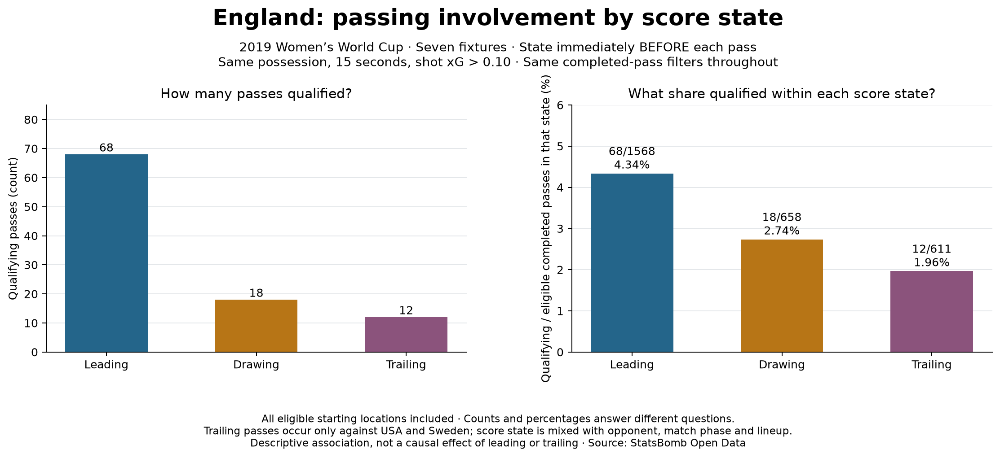

# England passing involvement by pre-pass score state

## Question and scope

Does England's observed qualifying share of eligible completed passes differ while
leading, drawing or trailing? This lesson returns to **the whole team and all starting
locations**; it is not the attacking-third Kirby/Bronze comparison from lessons 20–21.
The seven fixtures, 2,837 eligible passes and 98 selected IDs are unchanged. The
selection remains completed possession-team passes, listed restarts excluded, within
15 nominal seconds before a same-possession England shot with xG strictly above 0.10.

## Reconstruct the state before the pass

Walk all events in event-index order from 0–0. At each eligible pass, save England's
score, the opponent's score and the corresponding state. Only then apply a recorded
goal update when its event is reached. A pass before a goal receives the pre-goal state,
including when pass and goal share the same nominal second. Halftime does not reset
the score. Shootout-period events are ignored.

Goals come from Shot events with Goal outcomes, including penalties. Canonical
Own Goal Against events credit the opponent; Own Goal For counterparts are ignored
to avoid double counting. No own goals occur in these seven cached fixtures. The
implementation is checked against each fixture's provider final score and is scoped
to this dataset; unsupported source changes should fail the audit, not be guessed.
All seven reconstructed scores match the downloaded provider match metadata.
The metadata URL and SHA-256 are stored in the evidence alongside the existing event
input manifest. No provider Git revision is inferred from a content hash.

## Results

- Leading: 68 qualifying passes / 1,568 eligible completed passes = **4.34%**.
- Drawing: 18 / 658 = **2.74%**.
- Trailing: 12 / 611 = **1.96%**.

## Interpretation and limits

The observed share is highest while leading in these matches. This does not establish
that leading caused better passing or that trailing reduced a player's ability.
**England only trailed against USA and Sweden** in this sample: score state is mixed
with opponent, game phase, lineup and other context. More data across comparable
situations is needed to separate these factors. Counts measure selected involvement;
shares use completed passes, not attempts or minutes. Neither is a completion rate,
unique-chance count, assist count, causal effect or fully adjusted performance rating.

The score label is assigned at the pass, even if the next shot changes the score.
Conditioning on a later score or final result would answer a different question and
introduce future information into this event label.

## Reproduce and audit

Run `python 22_score_state_context.py` after lesson 13 creates cached raw events. The
script also downloads competition-72/season-30 match metadata once if absent, with
an HTTP timeout, then uses its ignored local cache. Output
`data/22_score_state_evidence.json` preserves every eligible pass label, all-player
and per-match summaries, goal transitions, final-score checks and metadata digest.
The checker independently rebuilds pre-pass scores from cached event order when
available and checks every saved label against the saved goal timeline offline.
Unit tests cover same-second event order, halftime, shootout exclusion, own-goal
counterparts and undefined state denominators. Prepared and executed with assistance.

Primary source: [StatsBomb Open Data specification](https://raw.githubusercontent.com/statsbomb/open-data/master/doc/StatsBomb%20Open%20Data%20Specification%20v1.1.pdf)
for event and goal definitions; [provider match metadata](https://github.com/hudl/open-data/blob/master/data/matches/72/30.json)
for final scores. This is a project extension, not a copied Soccermatics lesson.
