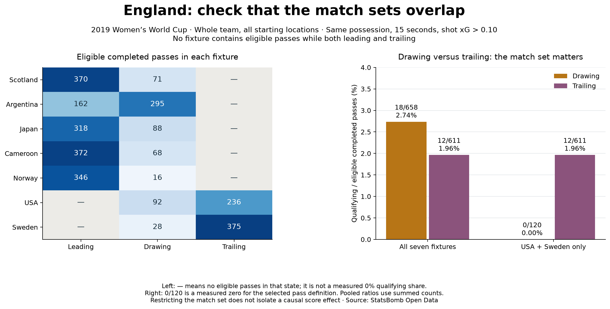

# Compare score states on a common fixture set

## Question

Does the score-state pattern from lesson 22 persist when both compared states have
eligible completed passes against the same opponents in the same fixtures?
The scope remains England's whole team, all starting locations, the same seven
fixtures, 15-second window, same-possession shots with xG > 0.10 and restart exclusions.

## Check overlap before calculating a comparison

For each pair of states, retain fixtures with a positive eligible completed-pass
denominator in **both** states. Do not require a positive qualifying numerator:
a measured zero is valid data. Recompute pooled ratios by adding counts before dividing.
The overlap rule uses exposure, not whether a fixture gives a preferred result.

No fixture contains eligible passes in both Leading and Trailing. A within-fixture
Leading-versus-Trailing comparison is therefore unavailable in this sample. Empty
restricted pools are saved as undefined shares (`null`), not 0% or evidence of equality.

Drawing and Trailing have common fixtures: USA (69258) and Sweden (69301).
Their individual comparisons are:

- USA: Drawing 0/92 = 0%; Trailing 4/236 = 1.69%.
- Sweden: Drawing 0/28 = 0%; Trailing 8/375 = 2.13%.

## What happens to the pooled result?

Across all seven fixtures, Drawing is 18/658 = 2.74% and Trailing is 12/611 = 1.96%.
Restricting both states to USA and Sweden gives Drawing 0/120 = 0% and Trailing
12/611 = 1.96%. The direction changes because the analysed fixture set changes.
All 18 Drawing-state qualifying passes in the seven-match pool come from the other
five fixtures. The original calculation is correct; it answers a broader pooled question.

## Interpretation and limits

The seven-match pooled association must not be described as a dependable effect of
trailing. In the two fixtures where Drawing and Trailing can both be observed,
Trailing has the higher selected share. This does not establish that falling behind
improves passing. Game phase, lineup, fatigue and tactics still vary; only two fixtures
are available and qualifying numerators are small.

Using the same fixture set also does not assign equal fixture weights: eligible-pass
volumes differ between states. Per-fixture results are therefore reported alongside
the restricted pooled ratio. No regression adjustment, equal-weight standardisation,
causal estimate, significance test or new confidence interval is claimed.
Zero Drawing qualifiers do not mean England made no shots or no useful passes:
none met the project's particular pass/shot eligibility definition in those periods.

## Reproduce and inspect

Run `python 23_within_match_score_comparison.py` in Spyder or a terminal. It uses saved
lesson-22 evidence with no download. `data/23_within_match_evidence.json` preserves
all-fixture coverage, the pairwise overlap rule, common fixture IDs, pooled ratios,
percentage-point differences and each common fixture's counts. Existing pass identities
and labels remain unchanged. The checker independently reconstructs these summaries
from the score-state ledger. Tests protect true zero numerators, missing overlap and
pooled counts rather than unweighted averages.

Prepared and executed with assistant support. The independent task is to rewrite an
overconfident score-effect claim using the reported scope and limits. Primary data
source: [StatsBomb Open Data](https://github.com/hudl/open-data); pass-selection foundation:
[Soccermatics pass heat maps](https://soccermatics.readthedocs.io/en/latest/gallery/lesson1/plot_PassHeatMap.html).
This comparison is a project extension.
