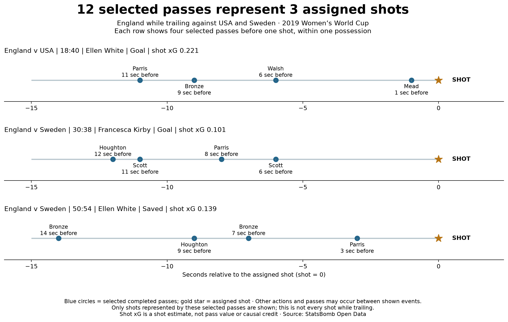

# Twelve passing actions are linked to three represented shots

## Question and scope

What does the 12-pass Trailing numerator from lessons 22–23 represent at shot and
possession level? Keep the same selection: eligible completed England passes, all
starting locations, made while trailing and within 15 nominal seconds before the
nearest subsequent same-possession shot with provider xG strictly above 0.10.
Each pass already has exactly one assigned eligible shot from lesson 14.

## Results

The 12 unique selected passes link to **three unique assigned shots**, in three
separate possessions. Each shot has four selected preceding passes:

- USA, 18:40: Ellen White, Goal, shot xG 0.22070982. Selected passers: Parris,
  Bronze, Walsh and Mead, at 11, 9, 6 and 1 seconds before the shot.
- Sweden, 30:38: Francesca Kirby, Goal, shot xG 0.1007295. Selected passers:
  Houghton, Scott, Parris and Scott, at 12, 11, 8 and 6 seconds before the shot.
- Sweden, 50:54: Ellen White, Saved, shot xG 0.13908964. Selected passers:
  Bronze, Houghton, Bronze and Parris, at 14, 9, 7 and 3 seconds before the shot.

The timeline shows passers in event order, not verified passer-to-recipient links.
Other passes, carries and actions may occur between shown events. It is not a complete
attack reconstruction, and these are not all England shots while trailing. Shots
without an eligible selected pass are absent. Three represented shots in three
possessions is a sample fact; one possession can in general contain multiple shots.

## A concrete duplication error

Counting provider xG once for each represented shot gives **0.46052896**. Summing the
associated shot xG once per pass instead gives **1.84211584**, because each of these
shots is repeated four times in the pass table. That second number is an intentionally
incorrect demonstration, not a reported team or player performance metric.

Neither value is pass-created xG or causal player credit. The correct deduplicated
sum covers only these represented shots, not every team attempt. The two observed
goals and the selected-shot xG sum are different quantities; three selected shots
cannot validate or invalidate a probability model.

## Method and checks

Filter lesson-14 selected IDs using lesson-22 Trailing labels, then group by match ID
and assigned shot ID. Count possessions by match, period and possession ID. Preserve
all selected pass identities and their nominal time gaps. Read the cached raw shot
events to verify shooter, outcome, clock, xG, period, possession and event ordering.
Selected pass timestamps precede the assigned shot in event-index order.

Run `python 24_passes_shots_and_possessions.py` in Spyder or a terminal after caching
raw events with lesson 13. Output `data/24_shot_units_evidence.json` saves all three
represented shots, the 12 linked passes, scores before the shots and summary units.
Tests reject repeated pass IDs and conflicting shot metadata, verify shot-xG
deduplication, and protect the possibility of multiple shots in one possession.
The standard-library checker reconciles all units, identities, gaps and sums, with
raw-shot verification when cache files are present.

Prepared and executed with assistant support. Independent practice is in
[lesson 24](../lessons/0006-passes-shots-possessions.html). Primary data:
[StatsBomb Open Data](https://github.com/hudl/open-data); the original
[Soccermatics pass selection](https://soccermatics.readthedocs.io/en/latest/gallery/lesson1/plot_PassHeatMap.html)
explicitly handles multiple shots and duplicate pass matches. This is our project audit extension.
