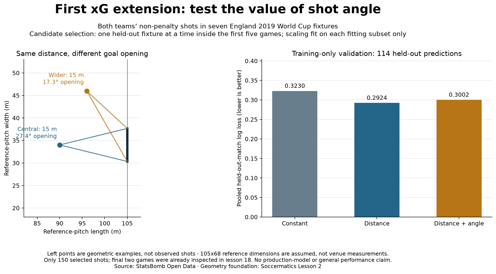

# Does adding shot angle improve the educational xG model?

## Question and design

Compare three predefined candidates: a constant training-goal-rate baseline,
distance-only logistic regression, and distance-plus-opening-angle logistic regression.
Use the same 150 non-penalty shots from both teams as lesson 18: first five fixtures
provide 114 shots/11 goals; the last two provide 36 shots/six goals. Provider xG is
not a predictor or target. The target remains the observed Goal outcome.

## Geometry and a controlled baseline

Map StatsBomb x/y to a normalised 105x68 reference pitch; the goal width is 7.32.
These are modelling assumptions, not measured venue dimensions. Distance is to goal
centre; opening angle is between vectors from the shot to the two posts. The atan2
formula handles the close-goal quadrant; exact post locations are rejected.

Both fitted candidates use the SAME reference-pitch distance. Lesson 18 instead used
Euclidean StatsBomb coordinate units. The new distance baseline is refitted accordingly;
its coefficients and evaluation figures are not an unchanged copy of lesson 18.
At a reference distance of 15 m, our illustrative central point has a 27.4-degree
opening, and a wider point a 17.3-degree opening. These are geometric examples, not
observed shots or fitted goal-probability predictions.

## Candidate selection inside training data

Hold out one of the first five fixtures; fit on the other four and predict every
shot in the held-out fixture. Repeat until every training shot has exactly one
out-of-fold prediction. Fit feature means/scales only on each fitting subset and
apply them unchanged to its validation fixture. No last-two-fixture shots enter
these fitting or validation subsets.

Select the candidate with the lowest **pooled out-of-fold log loss**, a probability
error measure. Brier score is secondary; do not choose a preferred metric after
seeing its result. Logistic fits are unregularised maximum-likelihood fits using BFGS;
all 12 logistic optimisations converge; six constant fits use the closed-form goal rate.
This grouped scheme is not forward-in-time validation and does not establish that
fixtures are independent representative samples.

## Results

Training-only grouped validation:

- Constant: log loss 0.322997; Brier 0.088149.
- Distance: log loss **0.292377**; Brier **0.084712**.
- Distance plus angle: log loss 0.300214; Brier 0.085748.

The selected candidate is **distance-only**. Adding angle did not improve the primary
validation score in this sample. This is not evidence that angle is unimportant in
football or that the simpler model is universally preferable.

## Reused final-two-fixture check

After fixing the selection from training-only validation, refit each candidate on
all 114 training shots and predict the final 36. The distance candidate records log
loss 0.407105 and Brier 0.131533; distance plus angle records 0.438443 and 0.139735.
These two fixtures were already inspected in lesson 18. Their scores are an explicitly
**reused exploratory check**, not a fresh independent final evaluation or selection
criterion. Reporting all candidates does not make the check independent again.

## Interpretation and limitations

More predictors do not automatically improve validation results. Retain the simpler
candidate for this exercise and report the negative result. Only five training
fixtures and eleven training goals are available. Model selection makes the winning
validation score optimistic; a larger, fresh evaluation sample is needed. Pressure,
body part, defenders and goalkeeper position remain omitted. No calibration,
significance, production-model quality or general scouting reliability is claimed.
The passing study continues to use supplied StatsBomb xG, unchanged.

## Reproduce and audit

Run `python 25_shot_angle_model.py` in Spyder or a terminal using the existing core
requirements. It reads saved lesson-18 evidence without a new download. JSON output
preserves all transformed shots, fold identities, fold-local scaling, coefficients,
predictions, primary selection rule and reused-check scores. The standard-library
checker independently checks angles using goalpost vector dot products, verifies all
folds and transforms, recomputes every probability and score, and checks fitting
likelihood gradients without refitting. Unit tests cover geometry, grouped folds,
stored scaling and probability scoring. Implementation and reporting were prepared
with assistance.

Primary sources: [Soccermatics xG lesson](https://soccermatics.readthedocs.io/en/latest/gallery/lesson2/plot_xGModelFit.html)
for geometric features; [scikit-learn grouped validation](https://scikit-learn.org/stable/modules/generated/sklearn.model_selection.LeaveOneGroupOut.html)
and [training-only preprocessing guidance](https://scikit-learn.org/stable/modules/cross_validation.html)
for the validation design. We implement these steps directly; scikit-learn is not
an added dependency. Data: [StatsBomb Open Data](https://github.com/hudl/open-data).
