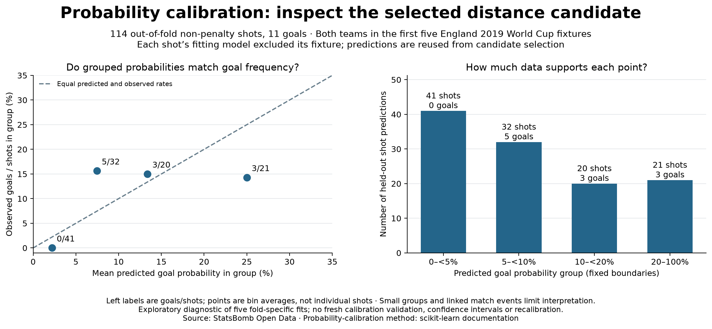

# Do the model probabilities match observed scoring rates?

## Question and scope

Inspect the selected distance candidate's 114 out-of-fold probabilities from lesson
25. These cover both teams' non-penalty shots in the first five England 2019 fixtures,
with 11 goals. Each probability came from a fitting model that excluded that shot's
fixture. The same predictions were used for candidate selection: this diagnostic
reuses development evidence and is not a fresh test. It pools five fold-specific
fits, not predictions from one final refitted model. No recalibrator is fitted.

## Method

Use fixed prediction bands [0,0.05), [0.05,0.10), [0.10,0.20) and [0.20,1]. Exact
boundary values go into the band starting at that boundary; probability 1 belongs to
the last band. Each unique shot belongs to exactly one band. Within each band,
compare the mean predicted probability with goals divided by shots. Preserve the
shot identities and counts; an empty band's mean and goal rate are undefined.

## Observations

- Below 5%: 41 shots, zero goals; mean prediction 2.195%, observed rate 0%.
- 5% to below 10%: 32 shots, five goals; mean prediction 7.461%, observed rate 15.625%.
- 10% to below 20%: 20 shots, three goals; mean prediction 13.379%, observed rate 15%.
- 20% through 100%: 21 shots, three goals; mean prediction 25.001%, observed rate 14.286%.

Summed probabilities are 11.214 predicted goals versus 11 observed goals. Close
agreement in that aggregate does not guarantee close agreement within probability
groups. These are group-level sample frequencies, not known true xG labels for
individual shots. A zero-goal group does not establish zero scoring probability.

## Interpretation and limits

Observed group frequencies differ from mean probabilities in this sample. This is
an exploratory diagnostic, not proof of systematic miscalibration or calibrated
population probabilities. Each band contains only 20–41 shots, goals are sparse,
shots share match context, and the development data were used for model selection.
The broad top band combines varied probabilities; bin choices affect the picture.
No error bars or formal significance test assume that these shots are independent.

A lower validation log loss selects a candidate within the exercise; it does not
by itself validate calibration or practical suitability. Larger, fresh representative
match data is needed. No probability correction or additional model fitting is
performed here, and no previously inspected test fixtures are relabelled as fresh.
Provider xG used in the original passing case study remains unchanged.

## Reproduce and audit

Run `python 26_probability_calibration.py` in Spyder or a terminal using the existing
Matplotlib dependency. It reads saved lesson-25 evidence without downloading data.
`data/26_calibration_evidence.json` stores every out-of-fold shot probability and
outcome, group membership, prediction sum, rates and overall totals. The checker
rebuilds the records directly from the selected candidate's folds, verifies exclusion
of the last two fixtures, checks every bin and reconciles all totals. Tests cover
boundaries, empty versus zero-goal groups, mean predictions versus observed outcomes,
invalid probabilities and duplicate shots.

The implementation and interpretation were prepared with assistant support.
Primary method reference: [scikit-learn probability calibration](https://scikit-learn.org/stable/modules/calibration.html),
particularly reliability diagrams and bin averages. We implement the diagnostic
directly; no scikit-learn dependency is added. Data: [StatsBomb Open Data](https://github.com/hudl/open-data).
