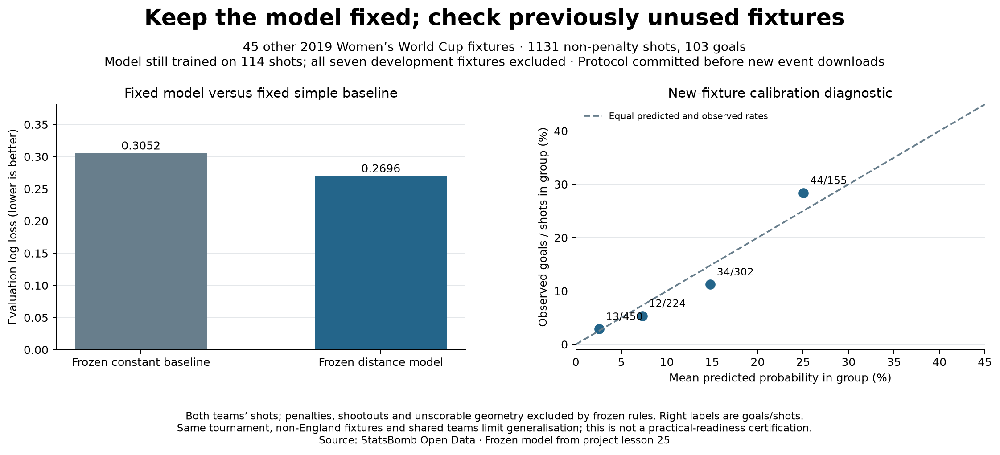

# Keep the model fixed and check previously unused fixtures

## Why this evaluation was added

The earlier xG exercise fitted only 114 shots and reused small development checks.
This evaluation asks a narrower, answerable question: does that **unchanged model**
beat its unchanged simple baseline on previously unused fixture shot events?
It does not increase the model's training sample or certify professional readiness.

## Protocol frozen before new shot-event downloads

The [protocol commit](https://github.com/alirezzaww/england-2019-attacking-pass-analysis/commit/d3b76cb)
precedes event-file loading. It records the selected distance fit, its scaling and
coefficients, the constant baseline fit, exact fixture IDs, source hashes, exclusions,
primary log loss, secondary Brier score, calibration bands and paired match-bootstrap
settings. No refitting, new candidate selection, parameter tuning or outcome-based
fixture filtering occurs in this analysis. A code digest prevents silently changing
the prediction implementation. No practical-readiness threshold was defined.

The 52-fixture provider metadata was already cached, including match scores. We
selected **all 45 fixtures outside the seven development games**, irrespective of
results, before downloading their shot-event files. These are previously unused shot
events, not unknown public match outcomes or a new competition. None involves England;
the evaluation population differs from the earlier England-centred fixture sample.

## New evidence and exclusions

The 45 fixtures contribute **1,131 non-penalty shots and 103 goals**, from both teams.
Excluded under the frozen rules: 22 penalty-shot events and seven shootout events;
no missing or invalid geometry exclusions occurred. Raw hashes and identities are
preserved for every fixture. The original model is still trained on **114 shots,
including 11 goals**. Its baseline still predicts 11/114 for every shot; the baseline
is not refitted to the evaluation goal rate.

## Probability error on the new fixture set

- Frozen constant baseline: log loss **0.305178**, Brier **0.082806**.
- Frozen distance model: log loss **0.269628**, Brier **0.075398**.
- Model minus baseline: log loss **−0.035549**, Brier **−0.007407**.

Lower probability error is better. The model improves on this baseline on these
fixtures. These scores are not percentages of wrong classifications and do not
reveal a true xG label for an individual shot.

A paired whole-match bootstrap (5,000 draws, seed 20261031) pools shot losses after
resampling the same fixture indices for both models. The percentile intervals for
model-minus-baseline are −0.052104 to −0.019627 in log loss and −0.011415 to −0.003611
in Brier score. All draws are valid. These intervals depend on an approximate
exchangeable-match sampling assumption; shared teams and tournament structure limit
that assumption. They do not establish universal coverage or a readiness decision.

## Calibration inspection

Use the same bands fixed in the protocol:

- Below 5%: 450 shots, 13 goals; mean prediction 2.57%, observed rate 2.89%.
- 5% to below 10%: 224 shots, 12 goals; mean prediction 7.30%, observed rate 5.36%.
- 10% to below 20%: 302 shots, 34 goals; mean prediction 14.78%, observed rate 11.26%.
- 20% through 100%: 155 shots, 44 goals; mean prediction 25.04%, observed rate 28.39%.

The groups do not agree perfectly. Summed model probabilities give 111.36 predicted
goals versus 103 observed. The baseline's sum is 109.13, closer in that one aggregate,
but its per-shot probability errors are worse. Aggregate goal totals alone therefore
cannot decide which model gives better shot-level probability predictions.

## Supported conclusion and remaining limits

> The frozen geometric model had lower probability error than the frozen training-rate
> baseline on 1,131 shots from 45 previously unused fixtures in the same tournament.
> Calibration still shows group-level discrepancies. Broader reliability and practical
> suitability require additional context, representative data and task-specific criteria.

This is fixture-disjoint from development but not a different-season, unseen-team or
chronological future-forecast evaluation. Some evaluation fixtures precede the fitting
fixtures in calendar time. Both teams are represented, and teams recur across fixtures.
Only distance is used by the selected model; body part, pressure and defensive context
remain omitted. We have now inspected these evaluation results. Later tuning against
this set would make it development data; do not claim it remains untouched for later
model versions. Provider xG in the passing case study is unchanged.

## Reproduce and audit

Run `python 27_frozen_model_evaluation.py` with the core environment installed. No
refitting or original seven-match event cache is required: the committed protocol
supplies the frozen fits. New raw files download once into the ignored cache (about
133 MB), then reuse local files. To include this stage in the full pipeline, run
`python scripts/run_research.py --headless --extended-evaluation`. The default core
pipeline skips the large rerun but still checks the saved evaluation evidence.

The evidence records every included shot, outcome, fixed prediction, exclusion, source
hash, match loss summary, calibration band and bootstrap interval. Offline checks
recompute predictions and metrics and replay all bootstrap draws. When caches are
present, the checker independently reconstructs all included/excluded shot records,
verifies fixture teams and all 45 raw hashes. Tests cover membership, probability loss,
paired resampling and pooling/repetition of match shot totals.

Prepared and executed with assistant support. Sources:
[StatsBomb Open Data](https://github.com/hudl/open-data),
[Soccermatics xG geometry](https://soccermatics.readthedocs.io/en/latest/gallery/lesson2/plot_xGModelFit.html),
[probability calibration](https://scikit-learn.org/stable/modules/calibration.html), and
[bootstrap method reference](https://docs.scipy.org/doc/scipy/reference/generated/scipy.stats.bootstrap.html).
