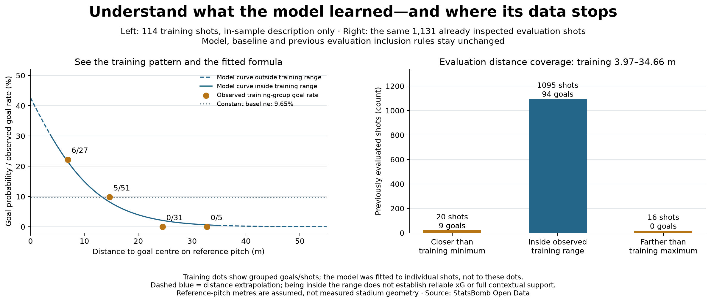

# What distance pattern did the model learn, and where are examples missing?

## Purpose and unchanged model

Make the learned distance relationship concrete, then inspect its one-feature data
coverage. This is an in-sample description and post-evaluation diagnostic. It does
not train a new model, provide a fresh evaluation or remove shots from lesson 27.
All distances are on the assumed 105x68 reference pitch, not venue measurements.

## Training counts

The 114 original training shots contain:

- Below 10 m: 6 goals / 27 shots = 22.22%.
- 10 m to below 20 m: 5 / 51 = 9.80%.
- 20 m to below 30 m: 0 / 31 = 0%.
- 30 m and beyond: 0 / 5 = 0%.

The fitted negative distance coefficient describes a decreasing scoring-probability
curve. It was learned from the individual training shots, not by joining these
four points or using a bin's empirical percentage as each shot's xG. The plotted
markers are at each group's mean distance. A group's percentage and a prediction
at one exact distance answer different questions. Zero sample goals do not establish
zero scoring probability.

Actual outputs of the frozen model are 0.149467 at 10 m, 0.039851 at 20 m and
0.009708 at 30 m. The constant baseline remains 11/114 = 0.096491 at every distance.
These are model estimates, not known true xG values for individual shots.

## Training distance range and evaluation coverage

The observed training range is **3.970391 to 34.661342 m**. Using full-precision
boundaries, with both endpoints included in the inside-range category:

- Closer than the training minimum: **20 evaluation shots, nine goals**.
- Inside the observed training distance range: **1,095 shots, 94 goals**.
- Farther than the training maximum: **16 shots, zero goals**.

All 1,131 previously evaluated shots remain in the audit, including the 36 outside
the training range. No outcome-dependent exclusions, clipping or recalibration are
introduced. The closer shots span 1.671169–3.948880 m; farther shots span
34.825415–51.625 m.

## Interpretation and limitations

An estimate at a distance outside the observed fitting range is distance extrapolation:
the parametric formula extends beyond the examples it saw. That is a reason to inspect
support and assess performance, not a claim that every such estimate must fail.
Being inside the minimum/maximum range also does not establish reliable xG: training
is sparse in some regions and angle, body part, defenders and other context differ.
This audit covers only one numeric feature, not full distributional overlap.

The left plot is in-sample and must not be presented as proof of predictive quality.
The right plot reuses the already inspected lesson-27 evaluation; it is not a new
validation cohort or a newly trained model. The primary lesson-27 results and frozen
protocol are unchanged. More representative examples and reserved future evaluation
data are needed before claiming broad model reliability.

## Reproduce and inspect

Run `python 28_training_distance_support.py` in Spyder or a terminal. It reads saved
lesson-25 training rows, the lesson-27 protocol and saved evaluation predictions;
no download or fitting is required. Output `data/28_distance_support_evidence.json`
keeps every group's shot identities, counts, rates, distance boundaries and actual
frozen-model examples. The checker independently reconstructs both partitions and
all predictions. Tests cover exact band/range boundaries, empty versus observed-zero
groups and default/extended pipeline ordering. The extended evaluation runs before
its support diagnostic when explicitly requested.

Prepared and executed with assistant support. Course foundation:
[Soccermatics xG lesson](https://soccermatics.readthedocs.io/en/latest/gallery/lesson2/plot_xGModelFit.html).
Background on the outside-data-range concept:
[SciPy extrapolation guide](https://docs.scipy.org/doc/scipy/tutorial/interpolate/extrapolation_examples.html);
that guide discusses interpolators, whereas this project extends a logistic formula.
Data: [StatsBomb Open Data](https://github.com/hudl/open-data).
